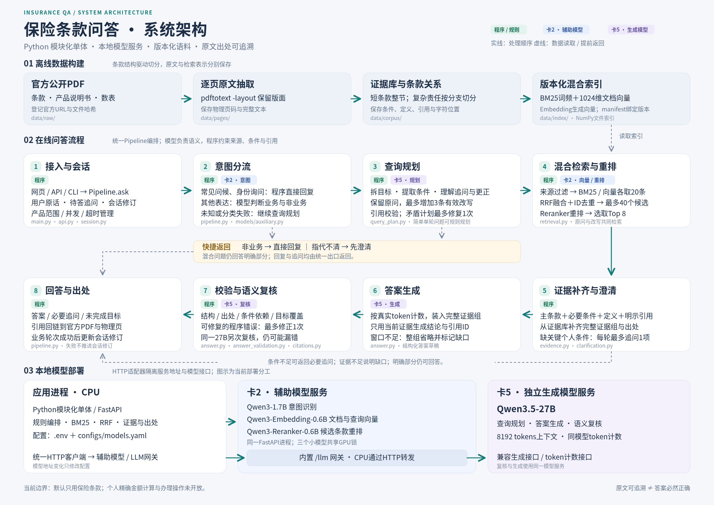

# 保险条款问答

面向太保盛世鸿运S（恒赢版）终身寿险（分红型）的问答项目。使用本地模型、混合检索和版本化证据库，提供带原文出处的回答、必要追问与多轮条件更正。网页、API和CLI共用同一问答流程。

## 运行

需要Python 3.10以上。首次运行时安装依赖，并从 `.env.example` 创建 `.env`，配置可访问的模型服务地址：

```bash
python -m venv .venv
source .venv/bin/activate
pip install -r requirements.txt
cp .env.example .env
python main.py
```

访问 `http://127.0.0.1:8000/`，API说明在 `/docs`。已有虚拟环境时，激活环境后直接运行 `python main.py`。

```bash
python main.py ask '这个保险能保多久？'
python main.py chat
```

`chat` 中用 `/new` 新建会话，用 `exit` 退出。模型地址在 `.env`，模型参数在 [configs/models.yaml](configs/models.yaml)，来源范围、索引版本和会话设置在 [configs/pipeline.yaml](configs/pipeline.yaml)。

## 数据与构建

原始PDF、逐页文本、证据库和索引分别位于 `data/raw/`、`data/pages/`、`data/corpus/` 和 `data/index/`。修改原文或切分规则后，重新构建：

```bash
python main.py build-corpus
python main.py build-index --build-dir data/corpus/<语料版本>
```

将 `<语料版本>` 替换为构建返回的目录名，并将索引返回的 `build_id` 写入 `configs/pipeline.yaml`。

```bash
python main.py doctor
python main.py build-index --check
```

`doctor` 和 `/health/ready` 检查本地配置与数据，不实时探活模型；`build-index --check` 校验已配置的索引，不需要 `--build-dir`。

## 架构与边界



原问 → 意图分流与查询规划 → BM25和向量召回 → RRF融合与重排 → 条件、定义和出处补齐 → 必要追问或回答生成 → 程序检查与模型复核 → 答案及PDF出处。

默认仅使用保险条款 `terms_only`。产品说明书须显式启用扩展来源；个人精确金额计算和办理操作未开放。每轮最多提出一个有条款依据的必要追问。会话保存在单进程内存中，30分钟无成功交互后失效，重启后需新建会话。默认关闭处理记录写入。

- [一页架构图](docs/architecture.svg)／[PDF版](docs/architecture.pdf)
- [架构说明](docs/architecture.md)、[数据说明](data/README.md)、[模型部署](deploy/README.md)
- `data/evaluation/`：题目要求的官方20问、自建12问及对应评分标签。

代码从 [main.py](main.py) 和 [pipeline.py](insurance_qa/pipeline.py) 开始阅读，再看查询规划、检索、证据与答案模块。
