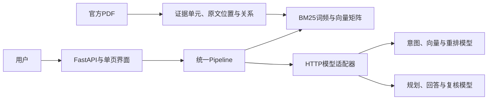

# 系统架构

系统采用 **Python模块化单体、本地模型服务与版本化证据库**。一页架构图见 [SVG](architecture.svg)／[PDF](architecture.pdf)。

`main.py` 是应用入口：`python main.py` 启动网页和API，`ask` 执行单次问答，`chat` 提供连续对话。业务代码位于 `insurance_qa/`；网页、API与CLI共用 `Pipeline.ask`。

## 模块与数据流



| 模块 | 职责 |
| --- | --- |
| `pipeline.py` | 调度业务步骤、控制超时、处理错误与提交会话 |
| `query_plan.py` | 编译查询草案，处理独立问题、追问与条件更正 |
| `retrieval.py` | BM25与向量召回、RRF融合和重排 |
| `evidence.py` | 补齐必要前提、定义和引用，打包原文出处 |
| `answer.py` | 生成结构化草稿、检查结论与引用、渲染回答 |
| `clarification.py` | 根据证据选择必要追问 |
| `session.py` | 管理用户原话、待答问题和会话修订 |
| `schemas.py` | 定义查询计划、召回结果、证据包与答案草稿等结构 |

模型通过HTTP适配器访问。规划、回答和复核使用Qwen3.5-27B；意图、向量与重排分别使用Qwen3-1.7B、Qwen3-Embedding-0.6B和Qwen3-Reranker-0.6B。模型地址与参数由 `.env`、`configs/models.yaml` 配置，部署方式见 [部署说明](../deploy/README.md)。

## 问答流程

原问与用户历史 → 意图分流与查询规划 → QueryPlan程序校验 → 混合召回与重排 → 前提、定义和引用补齐 → 必要追问或结构化回答生成 → 程序检查与模型复核 → 渲染出处 → 成功交付后提交会话修订。

常见问候和身份询问由程序直接响应，其他说法交由意图模型分类。非业务回复不写业务历史，也不改变待答追问；未知或分类失败继续规划。混合问题分别处理非业务与保险目标，身份介绍不使用条款引用。

无历史的明确单目标问题可用规则生成查询，其余问题调用规划模型。原问始终参与检索，最多增加3条有效改写；意图标签不直接过滤条款。改写单独校验，无效改写可以丢弃，核心计划错误最多修复一次。多轮补充和更正必须引用有效用户历史，不能把模型旧答案当作用户事实。

`plan` 查看查询计划，`search` 查看召回结果，`evidence` 查看补齐后的证据包。来源范围和版本由应用决定，模型不能生成页码、字符坐标或扩大资料范围。

## 语料与检索

原始材料保存在 `data/raw/`，逐页文本保存在 `data/pages/`。短条款整节保留，复杂责任按完整分支切分；跨页正文、脚注与定义不按长度截断。`text` 保存原文跨度拼接，`retrieval_text` 保存检索所用的标题、正文和必要前提。每条来源跨度绑定PDF哈希、物理页码与字符区间。

```bash
python main.py build-corpus
python main.py build-index --build-dir data/corpus/<语料版本>
```

语料构建生成证据、原文位置、关系、覆盖清单和manifest。将 `<语料版本>` 替换为返回的目录名；索引构建生成 `lexical.json`、`vectors.npy` 和manifest，并引用语料版本。应用通过 `configs/pipeline.yaml` 的 `build_id` 选择索引。请求使用固定快照，哈希、ID、向量维度或模型身份不符时返回错误。文件布局见 [数据说明](../data/README.md)。

默认 `terms_only` 仅允许条款，说明书扩展须显式开启。来源过滤发生在BM25统计和两路Top-K之前。BM25与NumPy精确向量检索各取20条，融合候选最多40条，重排后返回8条；未使用独立向量数据库。

原问权重为0.5，生成查询合计权重为0.5；没有生成查询时原问权重为1。候选按稳定ID去重，重排同时读取原问、改写与候选前提。向量调用失败可退回BM25，重排调用失败可退回RRF，并返回 `degraded`；模型或索引版本不匹配不降级为成功。

## 证据与回答

证据包补齐必要条件、定义和明示引用。预算不足时整组省略并报告缺口，不截断条件后给出结论。引用其他分支的计算内容时保留引用角色，不继承该分支全部适用前提。存在公式版面风险的证据组不参与自动金额计算。

完整模型输入使用同一模型的tokenizer计数，包含聊天模板并预留输出空间；计数失败不退回字符估算。上下文上限为8192 tokens，规划、回答、复核的输出上限分别为1536、2048、768 tokens，整轮请求时限为90秒。

答案由结构化陈述和引用组成。程序检查来源、依赖、能力范围及有限产品约束，模型复核语义支持与目标覆盖。首次程序检查中可修复的错误最多重新生成一次；来源无效、用户前提错误、服务错误和复核失败不触发该修正。被复核否定的部分陈述及其依赖可以删除，其他独立内容仍须通过检查后交付。程序检查与模型复核不构成正确性保证。

默认未开放个人精确金额计算或办理操作。结果分别表达执行状态、回答状态与目标覆盖情况；服务故障不能转述为条款缺失。复合问题可保留有依据的部分，并明确尚未完成的目标。

## 会话与接口

每轮最多提出一个有条款依据且能推进当前目标的必要追问。已知条件不重复索取；明确回答“不清楚”时保留待补问题，允许稍后补充或切换话题。

会话保存用户原话、待答与已问问题，默认最多100个会话、每会话20轮，30分钟无成功交互后失效。会话位于单进程内存，重启后失效。`session_id` 和 `expected_revision` 用于续接与并发校验；只有成功交付才提交修订，失败不推进修订号或刷新有效期。

`GET /health/live` 检查进程，`GET /health/ready` 检查配置与本地数据，不实时探活模型。`POST /api/chat` 调用统一流程，服务故障和校验失败分别返回503和422。默认 `write_traces: false`，不写入处理记录。
